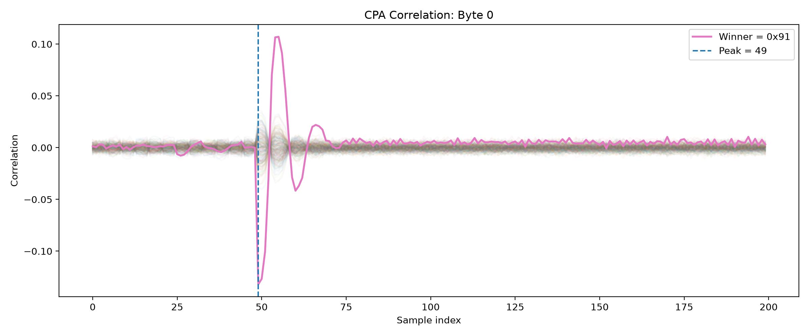

# Recovering the Fake Key of an AES-128 Side-Channel Countermeasure

CPA attack on power traces from an AES-128 FPGA design whose final round is protected by a **fake-key countermeasure**. The design keeps the power-to-key link intact but points it at a fake key wired into the data path. A lookup table cancels the fake key out, so the ciphertext is still standard AES under the real key. A normal CPA attack converges cleanly, but on a key the device never applies.

This project recovers that fake round-10 key and measures how many traces the attack needs.

## Results

| Metric | Value |
| --- | --- |
| Traces / samples per trace | 100,000 / 200 |
| Key bytes recovered | 16 / 16 |
| Recovered fake round-10 key | `91 DE C0 68 E3 FA CE 45 99 CE 38 F4 20 86 3A 30` |
| Leakage peak | Samples 49-50 for all bytes, \|r\| ≈ 0.12-0.18 |
| Minimum traces (original order) | 1,852 (stable from there on, 1-trace resolution) |
| Minimum traces (100 shuffled trials) | Median 2,150, 90th percentile 2,750, max 3,200 |
| Success rate across shuffled trials | 90% at 2,650 traces, 95% at 2,800 traces, 100% at 3,200 traces |



*Byte 0: the winning guess (0x91) stands out clearly from the other 255 guesses. Plots for all 16 bytes are in `notebooks/figures/cpa/`.*

The actual and fake keys are withheld by the challenge, so "recovered" means the key CPA converges on using all 100,000 traces. The minimum-trace experiments measure how quickly a subset of traces reaches that same key.

## How it works

1. For each of the 16 key bytes, guess all 256 values.
2. For each guess, predict leakage as the Hamming distance between the last-round input byte (`InvSBox(ciphertext[i] ⊕ guess)`) and the ShiftRows-related ciphertext byte.
3. Compute the Pearson correlation between predictions and the measured traces at every sample.
4. Pick the guess with the highest absolute correlation.

A byte counts as recovered only when the expected value is the unique top-scoring guess. A trace count counts as sufficient only if the full key stays correct at every larger tested count.

## Notebooks

| Notebook | Purpose |
| --- | --- |
| `01_datasetInspection.ipynb` | Inspect the raw CSV |
| `02_dataPreprocess.ipynb` | Validate data, convert ciphertexts to bytes, save arrays |
| `03_AESLeakageModel.ipynb` | Build leakage hypotheses for all bytes and guesses |
| `04_CPA_Attack.ipynb` | Run CPA and save the recovered key and plots |
| `05_minimumTraces.ipynb` | Minimum-trace search, 100 shuffled trials, Wilson 95% CIs |

## Usage

The dataset is not included. Place it at `data/Round10_traces.csv`: no header, one 32-character hex ciphertext column followed by 200 power samples per row.

```bash
git clone https://github.com/k-o-c-o/aesSca.git
cd aesSca
python -m venv .venv
source .venv/bin/activate        # Windows: .venv\Scripts\activate
pip install numpy pandas matplotlib jupyter
jupyter lab
```

Open the notebooks from the `notebooks/` folder (they use relative paths) and run them in order, 01 to 05. Outputs go to `notebooks/results/` and are git-ignored.

## Limitations

- The actual round-10 key and master key are not recovered. The countermeasure protects only the final round, so recovering the real key needs a different attack.
- Thresholds are empirical and specific to this dataset, leakage model, and sample window.
- The 1,852-trace figure is for one trace ordering; the shuffled trials give the more representative range.

## License

No License provided. 
